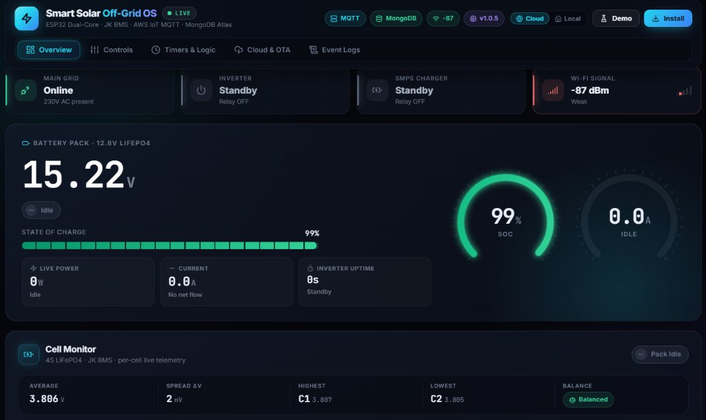
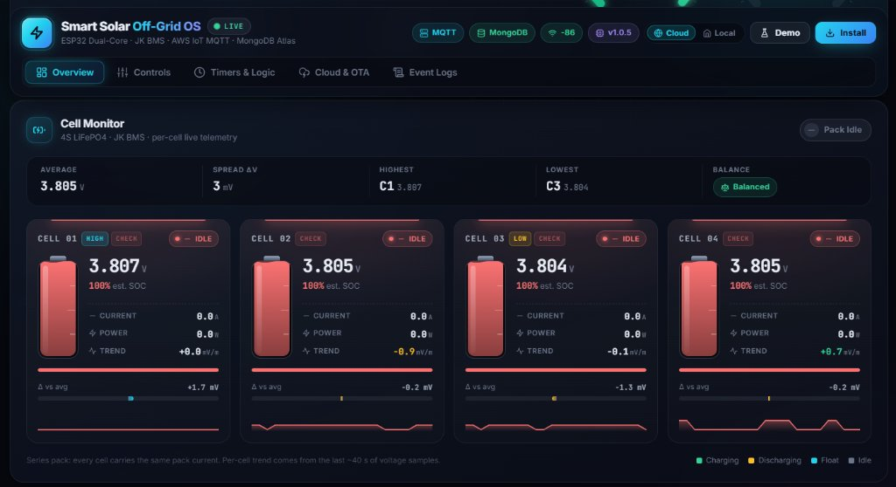
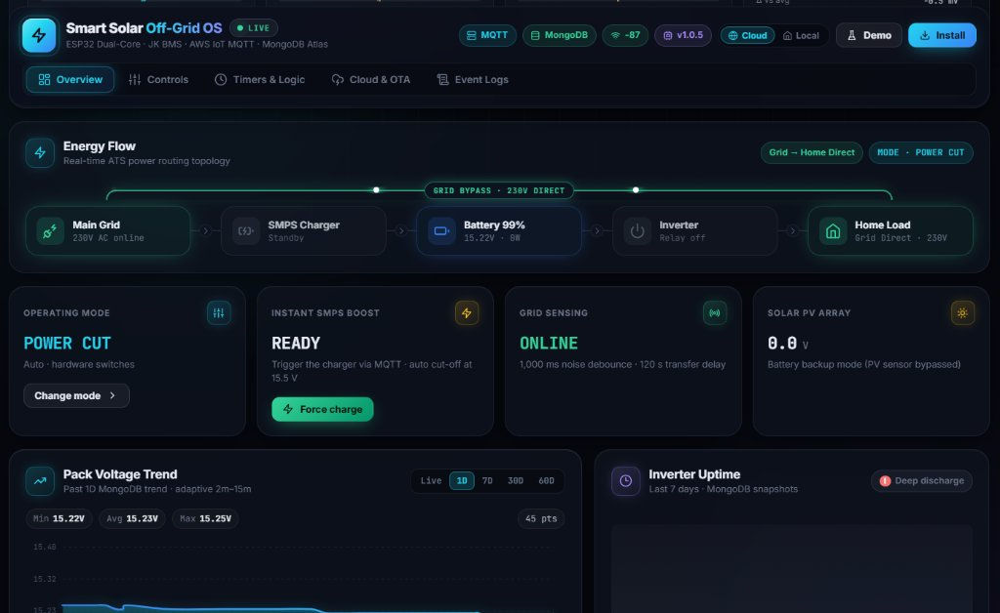
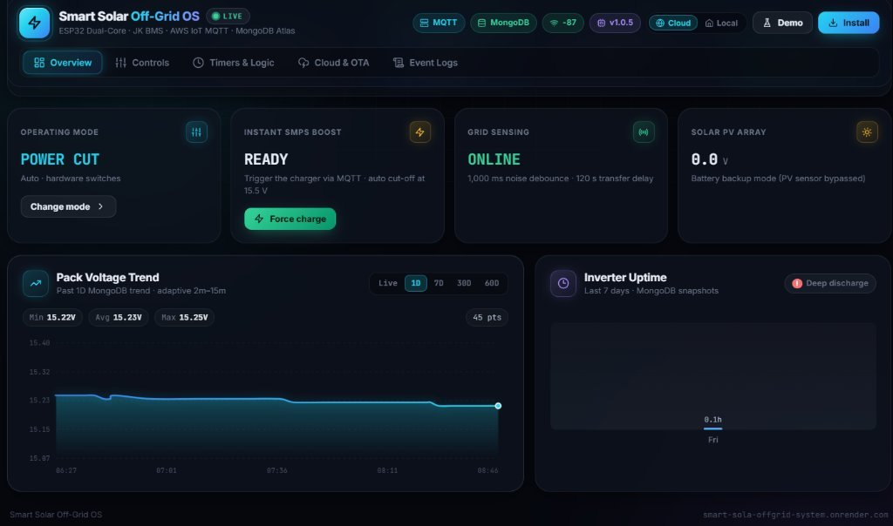
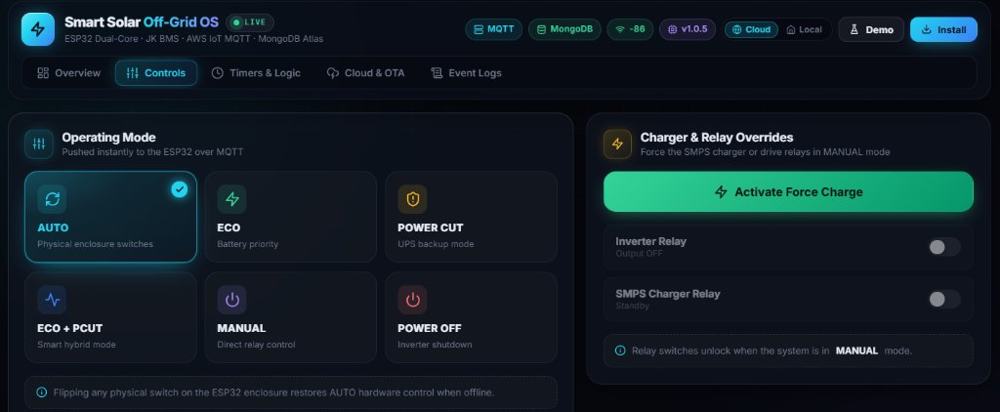
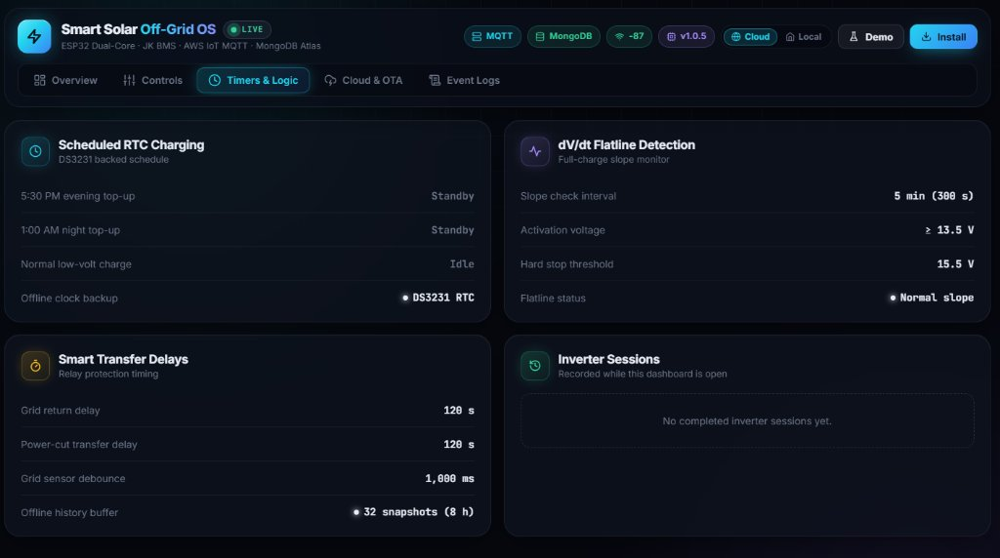
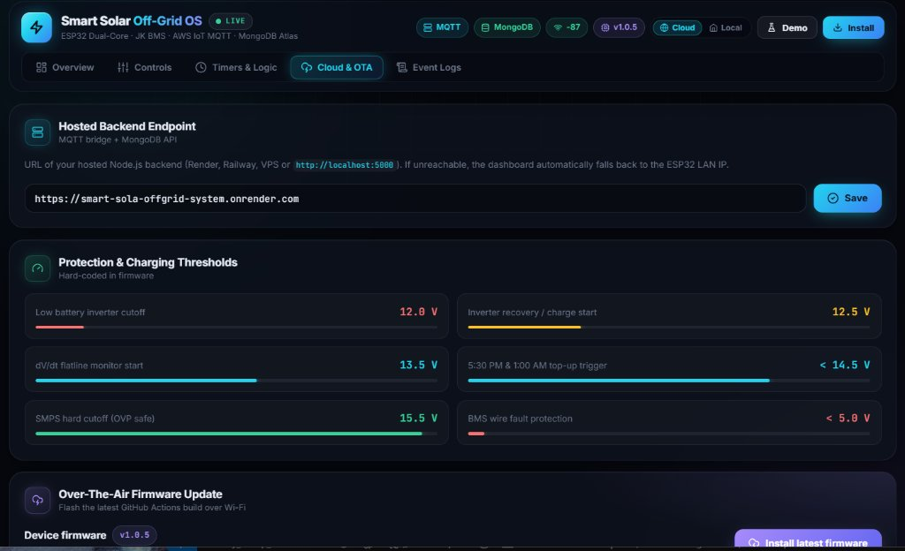
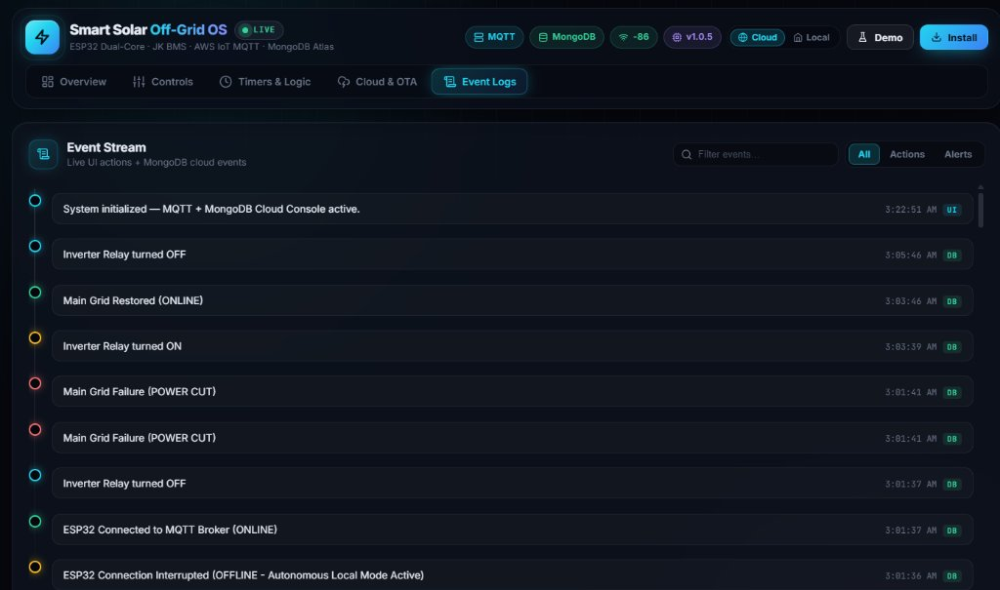
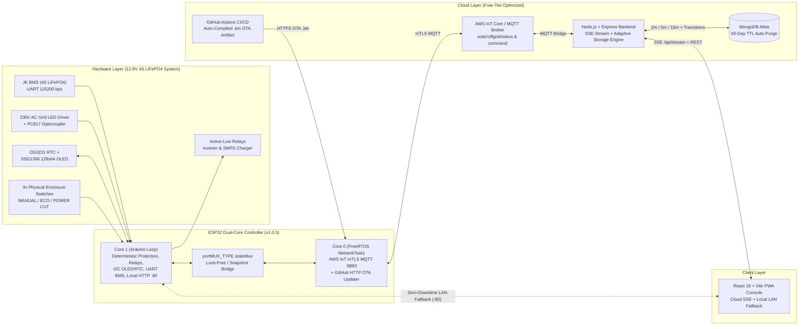

# ⚡ Smart Solar Off-Grid OS (v1.0.5)


An industrial-grade, autonomous **12.8V (4S LiFePO4) Off-Grid Power Management & Automatic Transfer Switch (ATS) System** powered by a **Dual-Core ESP32**, **JK BMS RS485/UART telemetry**, **DS3231 Precision RTC**, **AWS IoT Core (mTLS MQTT)**, **Node.js + MongoDB Atlas adaptive telemetry engine**, and an installable **React 18 Progressive Web App (PWA)** dark energy console.

---

## 📸 Live Hardware Dashboard Gallery

### 1. Overview Console & Pack Telemetry Hero
Real-time header badges (`LIVE`, `MQTT`, `MongoDB`, Wi-Fi RSSI `-dBm`, firmware `v1.0.5`, Cloud/Local transport badge, interactive Demo simulator, and 1-click PWA install), 4-card KPI strip, and Battery Pack Hero with dual radial SOC (`%`) and Current (`A`) gauges.



---

### 2. 4-Cell LiFePO4 Monitor (JK BMS Live UART Telemetry)
Per-cell live diagnostics for `CELL 01` – `CELL 04` including average cell voltage, cell spread (`ΔV` in `mV`), highest/lowest cell badges, balance state, individual vertical battery fill animations, per-cell estimated SOC, series pack current/power, 40-second voltage slope trend (`mV/m`), `Δ vs avg` center-zero deviation bar, and per-cell sparkline.



---

### 3. 5-Node ATS Energy Flow Topology & Quick Status
Real-time Automatic Transfer Switch (ATS) power routing topology (`Main Grid` → `SMPS Charger` → `Battery` → `Inverter` → `Home Load`) with animated `GRID BYPASS · 230V DIRECT` top rail, active operating mode card, 1-click **Instant SMPS Boost (Force Charge)** trigger, grid sensing health, and solar PV backup indicator.



---

### 4. Multi-Range Pack Voltage Trend (`Live | 1D | 7D | 30D | 60D`) & Inverter Uptime
Interactive historical voltage chart backed by adaptive MongoDB Atlas snapshots with `Min / Avg / Max` summary pills and a 7-day Inverter Uptime bar chart computed from cumulative runtime epochs.



---

### 5. Operating Modes & Hardware Relay Overrides (`Controls` Tab)
Instant MQTT mode switching across 6 operating modes (`AUTO`, `ECO`, `POWER CUT`, `ECO + PCUT`, `MANUAL`, `POWER OFF`) plus direct SMPS Force Charge activation and manual relay toggles.



---

### 6. Scheduled RTC Charging, `dV/dt` Flatline & Smart Transfer Delays (`Timers & Logic` Tab)
Live visibility into DS3231 RTC scheduled top-ups (`5:30 PM` & `1:00 AM`), `dV/dt` full-charge slope detection (`5 min` window above `13.5 V`), `120 s` power-cut & grid-return transfer countdowns, `1,000 ms` optocoupler noise debounce, and the 32-snapshot (`8 h`) ESP32 RAM history ring buffer.



---

### 7. Cloud Endpoint, Hardware Protection Thresholds & GitHub Actions OTA (`Cloud & OTA` Tab)
Runtime backend URL configuration (with automatic Local LAN IP fallback), visual progress bars for all hard-coded firmware voltage protections (`12.0 V` – `15.5 V`), and 1-click Over-The-Air (OTA) firmware flashing from GitHub Actions builds.



---

### 8. Real-Time Cloud + UI Event Stream (`Event Logs` Tab)
Unified audit log combining live UI commands and persistent MongoDB Atlas system transitions (`Main Grid Failure`, `Main Grid Restored`, `Inverter Relay ON/OFF`, `SMPS Charger ON/OFF`, `MQTT Broker Online/Offline`) with instant search and `All | Actions | Alerts` filtering.



---

## 🏗️ System Architecture



### Dual-Core ESP32 Isolation (`Core 1` vs `Core 0`)
- **Core 1 (`loop()` — Deterministic Hardware Control):**
  - Exclusively owns **I2C (`Wire`)** for the **SSD1306 OLED** and **DS3231 RTC**, **UART2 (`Serial2`)** for the **JK BMS**, **NTP UDP sync**, physical switches, optocoupler grid sensing, and relay control.
  - Operates with **zero network blocking**: even if Wi-Fi or AWS IoT Core goes completely offline, Core 1 protects the battery and switches relays within milliseconds.
  - Runs a lightweight local **HTTP REST server on port `80`** (`/api/status`, `/api/history`, `/api/mode`, `/api/charge`, `/api/relay`, `/api/heartbeat`) for direct LAN fallback.
- **Core 0 (`NetworkTask` — Cloud MQTT & OTA):**
  - Manages Wi-Fi reconnection, **AWS IoT Core mTLS (`WiFiClientSecure` on port `8883`)**, JSON telemetry serialization, command parsing, and **HTTP Over-The-Air (`Update.h`)** firmware streaming.
  - Reads a thread-safe snapshot of hardware variables protected by `portMUX_TYPE stateMux` so I2C and UART buses are never contended across cores.

---

## 🔌 Hardware Pinout & Wiring Guide

| Component / Signal | ESP32 GPIO | Pin Mode / Logic | Hardware Notes |
| :--- | :--- | :--- | :--- |
| **JK BMS UART RX** | `GPIO 4` | `Serial2 RX` (`115200 8N1`) | Connects to JK BMS GPS/RS485-UART TX pin (`3.3V` logic) |
| **JK BMS UART TX** | `GPIO 5` | `Serial2 TX` (`115200 8N1`) | Connects to JK BMS GPS/RS485-UART RX pin (`3.3V` logic) |
| **I2C SDA (OLED + RTC)** | `GPIO 21` | `I2C SDA` (`3.3V`) | Shared by SSD1306 `0x3C` OLED & DS3231 `0x68` RTC |
| **I2C SCL (OLED + RTC)** | `GPIO 22` | `I2C SCL` (`3.3V`) | Shared by SSD1306 `0x3C` OLED & DS3231 `0x68` RTC |
| **Inverter Relay** | `GPIO 25` | `OUTPUT` (**Active-LOW**) | `LOW` = Relay ON (`invState = true`), `HIGH` = Relay OFF |
| **SMPS Charger Relay** | `GPIO 26` | `OUTPUT` (**Active-LOW**) | `LOW` = Relay ON (`smpsState = true`), `HIGH` = Relay OFF |
| **Grid Status Sensor** | `GPIO 33` | `INPUT_PULLDOWN` | `HIGH` (`3.3V` via Optocoupler) = Grid Online (`230V AC` present) |
| **Manual Mode Switch** | `GPIO 13` | `INPUT_PULLUP` (**Active-LOW**) | Physical switch to `GND` enables `MANUAL` mode |
| **Eco Mode Switch** | `GPIO 14` | `INPUT_PULLUP` (**Active-LOW**) | Physical switch to `GND` enables `ECO` (or `ECO + PCUT`) |
| **Power-Cut Mode Switch** | `GPIO 27` | `INPUT_PULLUP` (**Active-LOW**) | Physical switch to `GND` enables `POWER CUT` (or `ECO + PCUT`) |

### ⚡ Optocoupler Grid Sensing Circuit (`GPIO 33`)
To safely isolate `230V AC` mains from the ESP32:
1. A small `5V` or `12V` DC supply/LED driver powered by the `230V AC` grid drives the input LED of a **PC817 optocoupler** through a **`1 kΩ` series resistor**:
   - **At `5V` input:** $I_F \approx \frac{5\text{ V} - 1.2\text{ V}}{1000\ \Omega} = 3.8\text{ mA}$ (Safe, ideal trigger current).
   - **At `12V` input:** $I_F \approx \frac{12\text{ V} - 1.2\text{ V}}{1000\ \Omega} = 10.8\text{ mA}$ ($P \approx 0.11\text{ W}$, well within standard $0.25\text{ W}$ resistor and PC817 $50\text{ mA}$ maximum rating).
2. **PC817 Output Side:**
   - **Collector (Pin 4)** → ESP32 `3.3V`
   - **Emitter (Pin 3)** → ESP32 `GPIO 33` (configured with internal `INPUT_PULLDOWN`)
   - When the grid is ON, `GPIO 33` is pulled `HIGH` (`3.3V`). When the grid fails, `GPIO 33` drops `LOW` (`0V`) and triggers the `1,000 ms` noise debounce filter.

---

## 🧠 Intelligent Control, Charging & Protection Logic

### 1. Operating Modes
| Mode | ID | Behavior |
| :--- | :---: | :--- |
| **AUTO (Hardware Switches)** | `0` | Reads the physical enclosure toggle switches (`GPIO 13`, `14`, `27`). Flipping any physical switch automatically restores local hardware control if a cloud override was active. |
| **ECO Mode** | `1` | **Battery Priority:** Runs the home on Inverter power whenever battery voltage is healthy (`>= 12.5 V`), cutting off at `<= 12.0 V` and waiting for solar/scheduled recharge. |
| **POWER CUT Mode** | `2` | **UPS Backup Mode:** Keeps Inverter OFF while `230V AC` Main Grid is online. On a confirmed power outage (`> 1,000 ms` debounce), starts a `120 s` transfer countdown (if `batVolt >= 12.5 V`) before turning the Inverter ON. When the grid returns, runs a `120 s` stabilization countdown before switching the Inverter OFF. |
| **ECO + PCUT Hybrid** | `3` | Runs on Inverter during normal operation if battery is healthy, and automatically manages grid-return and power-cut transfer timers. |
| **MANUAL Mode** | `4` | Unlocks direct relay control from the dashboard (`Inverter Relay` & `SMPS Charger Relay`), while still enforcing hard safety cutoffs (`12.0 V` LVD, `15.5 V` OVP, BMS fault, and the Inverter-OFF charging interlock). |
| **POWER OFF** | `5` | Immediately shuts down the Inverter output while allowing scheduled/low-voltage SMPS battery charging when the Inverter is OFF. |

### 2. Strict Inverter-OFF Charging Interlock
> **Hardware Safety Rule:** Across **all operating modes** (including `MANUAL`, `Force Charge`, RTC scheduled top-ups, and `<= 12.5 V` recovery charging), the **SMPS Charger Relay (`GPIO 26`) is strictly permitted to turn ON only when the Inverter Relay (`GPIO 25`) is OFF (`!invState`) and Main Grid AC is ONLINE (`gridNormal`)**. If the Inverter turns ON at any point, the SMPS Charger is immediately disengaged.

### 3. Multi-Stage Smart Charging & Protection Thresholds
- **Low-Battery Inverter Cutoff (`12.0 V`):** Immediately turns OFF the Inverter Relay (`invState = false`) and latches `invCutOff = true` to prevent deep cell discharge.
- **Inverter Recovery & Auto-Charge Trigger (`12.5 V`):**
  - Clears `invCutOff` once pack voltage recovers to `>= 12.5 V`.
  - Automatically triggers SMPS charging (`chargeType = 1`) whenever `batVolt <= 12.5 V`, `gridNormal == true`, and `!invState`.
- **DS3231 RTC Scheduled Top-Up Windows (`5:30 PM` & `1:00 AM`):**
  - At `17:30` and `01:00`, if `batVolt < 14.5 V`, `gridNormal == true`, and `!invState`, the system initiates a scheduled top-up cycle (`chargeType = 2`).
- **`dV/dt` Full-Charge Slope (Flatline) Detection (`>= 13.5 V` over `5 min`):**
  - Once charging voltage reaches `>= 13.5 V`, the firmware records a baseline voltage every `300 seconds (5 minutes)`.
  - If the pack voltage fails to rise (`batVolt <= checkStartVolt`) over a full 5-minute window, the battery has reached absorption plateau and the SMPS charger automatically terminates cleanly.
- **Hard Over-Voltage Protection Cutoff (`15.5 V`):**
  - Immediately turns OFF the SMPS Charger Relay before the JK BMS triggers an individual cell over-voltage disconnect.
- **JK BMS Wire-Fault / Stale Telemetry Protection (`10,000 ms` timeout / `< 5.0 V`):**
  - If the JK BMS UART stream stops responding for `> 10 seconds` or pack voltage reads `< 5.0 V`, `bmsFault` is latched and **both Inverter and SMPS relays are immediately turned OFF** to prevent blind operation.

---

## ☁️ Free-Tier Rate-Limit & Adaptive MongoDB Storage Engine

Designed specifically to run **24/7 at $0/month** within **AWS IoT Core Free Tier** and **MongoDB Atlas M0 (512 MB) Free Tier** limits without losing high-resolution transition data:

1. **Smart ESP32 Active vs. Background Publishing:**
   - **Active Dashboard Window (`90s` lease):** While a user has the web dashboard open, the frontend sends a heartbeat every **60–65 seconds** (right before the 90s lease expires). During this active window, the ESP32 streams live telemetry every **`2 seconds`** for smooth real-time gauges.
   - **Autonomous Sleep Publishing (Dashboard Closed):** When no dashboard heartbeat is active, the ESP32 automatically throttles MQTT publishing to match the battery phase:
     - **Discharging (`Inverter ON` or `current < -0.5 A`):** every **`2 minutes`**
     - **Charging (`SMPS ON` or `current > 0.5 A`):** every **`5 minutes`**
     - **Idle / Standby:** every **`15 minutes`**
     - **State Transitions (`Grid`, `Inverter`, `SMPS`, `Mode`, `ChargeType`):** published **immediately** (`0 ms` delay).
2. **Adaptive MongoDB Atlas Persistence & 60-Day TTL Auto-Purge:**
   - The Node.js backend enforces the exact same adaptive intervals (`2m` discharging / `5m` charging / `15m` idle) plus a `15s`-debounced transition logger when writing to MongoDB.
   - Both `HistoryLog` and `EventLog` schemas carry a MongoDB **TTL index (`expireAfterSeconds: 5184000` = 60 days)** plus an hourly background pruner (`pruneExpiredRecords()`), keeping total database usage under ~10–15 MB perpetually.
3. **Extrema-Preserving Chart Downsampling:**
   - `GET /api/history` uses `downsampleMinMax()` to bucket long-range queries (`7D`, `30D`, `60D`) while preserving both the **minimum sag voltage** and **maximum peak charge voltage** in every bucket.

---

## 📡 API & MQTT Topic Reference

### MQTT Topics
| Topic | Direction | Payload Summary |
| :--- | :---: | :--- |
| `solar/offgrid/status` | `ESP32 → Broker` | `{ v, c1..c4, cur, soc, pv, inv, smps, grid, mode, cType, up, epoch, cd, rssi, fw, ip, bms }` |
| `solar/offgrid/command` | `Broker → ESP32` | `{"cmd":"heartbeat"}`, `{"cmd":"mode","val":0..5}`, `{"cmd":"charge"}`, `{"cmd":"relay","inv":0/1,"smps":0/1}`, `{"cmd":"ota","url":"..."}` |

### REST & Server-Sent Events (SSE) Endpoints (`backend/server.js`)
| Method & Route | Description |
| :--- | :--- |
| `GET /api/stream` | Real-time **Server-Sent Events (SSE)** stream pushing live telemetry & instant state transitions to the React dashboard |
| `GET /api/status` | Latest cached ESP32 telemetry snapshot + `mqttConnected` & `dbConnected` health flags |
| `GET /api/history?days=1\|7\|30\|60&limit=720` | Historical pack voltage, current, SOC, and relay state points (extrema-preserved) |
| `GET /api/history/daily?days=7` | Daily inverter runtime hours (`invHours`), `minVolt`, `maxVolt`, and `avgVolt` for the last $N$ days |
| `GET /api/events?limit=60` | Latest system and user action audit logs from MongoDB Atlas |
| `POST /api/events` | Persist a manual UI operator action (`mode change`, `force charge`, `relay toggle`, `OTA trigger`) |
| `GET /api/mode?set=0..5` | Switch ESP32 operating mode (`0=AUTO`, `1=ECO`, `2=PCUT`, `3=HYBRID`, `4=MANUAL`, `5=OFF`) |
| `GET /api/charge` | Trigger an instant SMPS Force Charge cycle (when Inverter is OFF and Grid is Online) |
| `GET /api/relay?inv=0\|1&smps=0\|1` | Toggle Inverter or SMPS relay in `MANUAL` mode |
| `POST /api/ota-update` | Trigger ESP32 Over-The-Air firmware update from the compiled GitHub Actions `.bin` artifact |
| `GET /api/heartbeat` | Renew the ESP32's 90-second active `2s` live-streaming lease |
| `GET /api/health` | Cloud service health check (Uptime, MQTT connection state, MongoDB state, last ESP32 seen timestamp) |

---

## 📂 Repository Structure

```text
smart-sola-offgrid-system/
├── .github/workflows/
│   └── ci-cd.yml                  # GitHub Actions: Compiles ESP32 .ino -> build/*.bin & verifies frontend
├── smart_offgrid_logic_/
│   ├── smart_offgrid_logic_.ino   # Dual-Core ESP32 Firmware (v1.0.5)
│   ├── JK_BMS.h                   # Non-blocking JK BMS UART state-machine parser + 10s fault timeout
│   ├── aws_certs.h                # Wi-Fi credentials & AWS IoT Core mTLS Root CA / Device Cert / Private Key
│   └── build/                     # Auto-compiled OTA binary output committed by GitHub Actions
├── backend/
│   ├── server.js                  # Express + MQTT Bridge + SSE Stream + Adaptive MongoDB Storage Engine
│   ├── models/
│   │   ├── HistoryLog.js          # Telemetry schema with 60-day TTL index & phase tagging
│   │   └── EventLog.js            # System/UI event log schema with 60-day TTL index
│   ├── scripts/
│   │   └── seedSampleData.js      # 5-day realistic 4S LiFePO4 solar cycle generator for testing
│   └── .env.example               # Backend environment template (MONGO_URI, MQTT_URL, TLS certs)
├── frontend/
│   ├── src/
│   │   ├── App.jsx                # Main dashboard controller, SSE/LAN fallback & Demo simulator
│   │   ├── index.css              # Glassmorphic dark energy console design system
│   │   ├── services/esp32Api.js   # Unified Cloud Backend -> Local ESP32 LAN IP failover client
│   │   ├── utils/battery.js       # 4S LiFePO4 SOC curve & cell metrics helpers
│   │   └── components/            # Header, StatusStrip, BatteryHero, BatteryCells, PowerFlow, Charts, Tabs
│   └── public/                    # PWA manifest.webmanifest, Service Worker (sw.js), and icons
├── docs/screenshots/              # Live hardware dashboard screenshots (01..08)
├── render.yaml                    # Render.com Blueprint for Backend Web Service
└── vercel.json                    # Vercel SPA routing config for Frontend PWA
```

---

## 🚀 Quick Start & Installation

### 1. ESP32 Firmware (`smart_offgrid_logic_/`)
1. Open `smart_offgrid_logic_/smart_offgrid_logic_.ino` in **Arduino IDE 2.x**.
2. Install the **ESP32 Board Package** (`esp32 by Espressif Systems`) and select **ESP32 Dev Module**.
3. Install required libraries via Library Manager:
   - `PubSubClient` (by Nick O'Leary)
   - `ArduinoJson` (by Benoit Blanchon, v6.x)
   - `Adafruit SSD1306` & `Adafruit GFX Library`
   - `RTClib` (by Adafruit)
4. Configure your Wi-Fi SSID/Password and AWS IoT Core mTLS certificates inside `smart_offgrid_logic_/aws_certs.h`.
5. Compile and flash to your ESP32 over USB (subsequent updates can be flashed wirelessly via the **Cloud & OTA** tab).

### 2. Node.js Cloud Backend (`backend/`)
```bash
cd backend
cp .env.example .env
# Edit .env with your MONGO_URI, MQTT_URL, and AWS IoT certificate paths (or inline PEMs)
npm install
npm start
```
- **Optional — Seed 5 Days of Sample Telemetry for Chart Testing:**
  ```bash
  npm run seed
  ```

### 3. React 18 PWA Dashboard (`frontend/`)
```bash
cd frontend
npm install
npm run dev
```
- Open `http://localhost:5173` in your browser.
- You can configure your hosted backend URL (`https://your-backend.onrender.com` or `http://localhost:5000`) directly inside the **Cloud & OTA** tab at any time, or click **Demo** in the top header to test the live 4-cell charging/discharging animations without hardware connected.

---

## 🔄 Automated Over-The-Air (OTA) Firmware Updates

1. Push any firmware change in `smart_offgrid_logic_/smart_offgrid_logic_.ino` (and bump `FIRMWARE_VERSION`) to the `main` branch on GitHub.
2. The GitHub Actions workflow (`.github/workflows/ci-cd.yml`) automatically installs `arduino-cli`, compiles the binary for `esp32:esp32:esp32`, and commits `smart_offgrid_logic_/build/smart_offgrid_logic_.ino.bin` back to the repository.
3. Open the web dashboard → **Cloud & OTA** tab → click **Install latest firmware**.
4. The backend publishes the raw GitHub `.bin` URL over MQTT (`solar/offgrid/command`), and the ESP32 streams the update onto its OTA partition, verifies the checksum, and reboots into the new firmware automatically.
